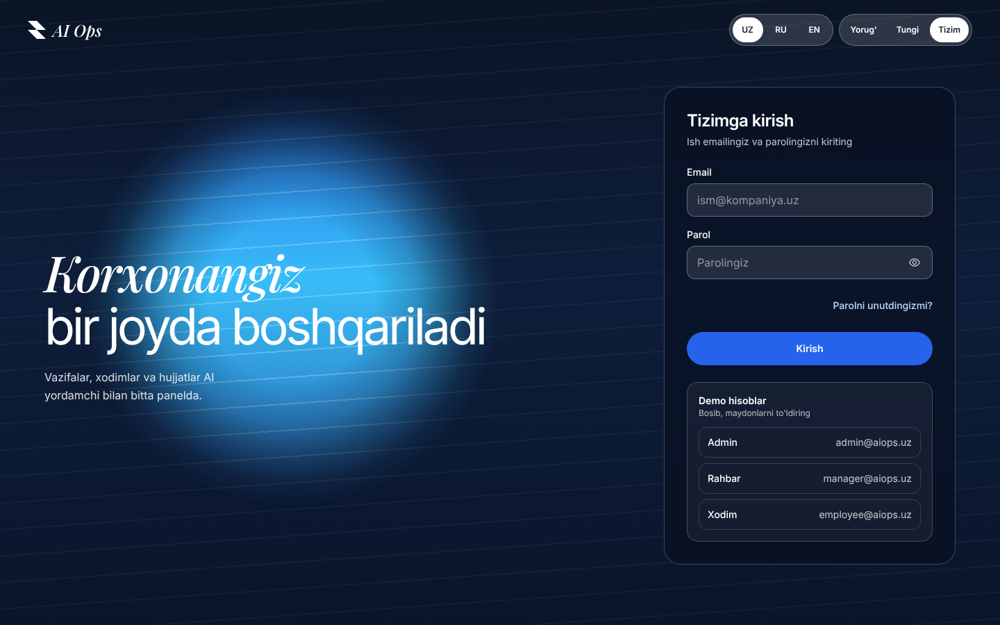
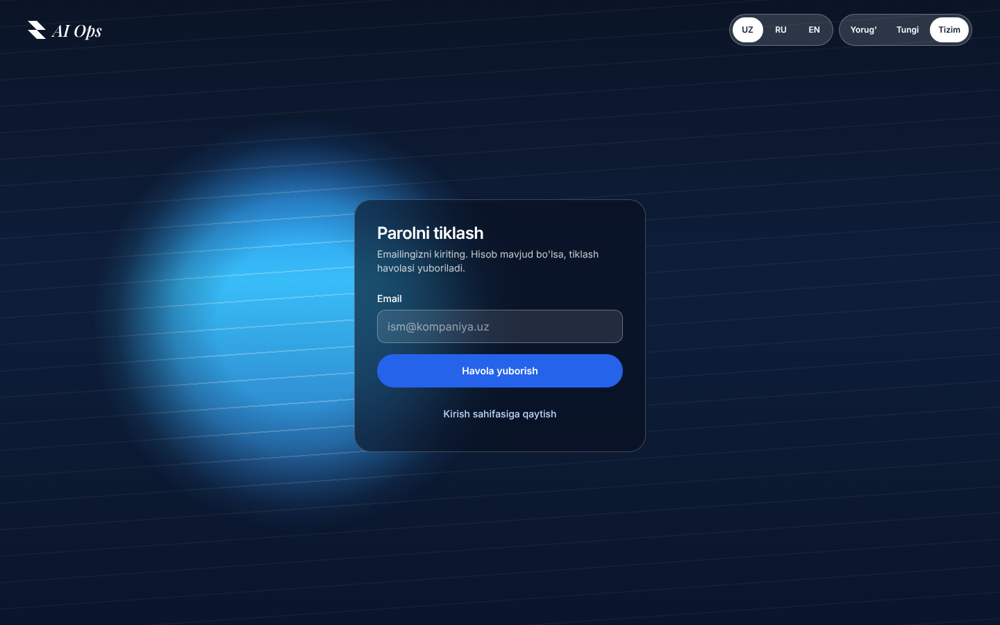
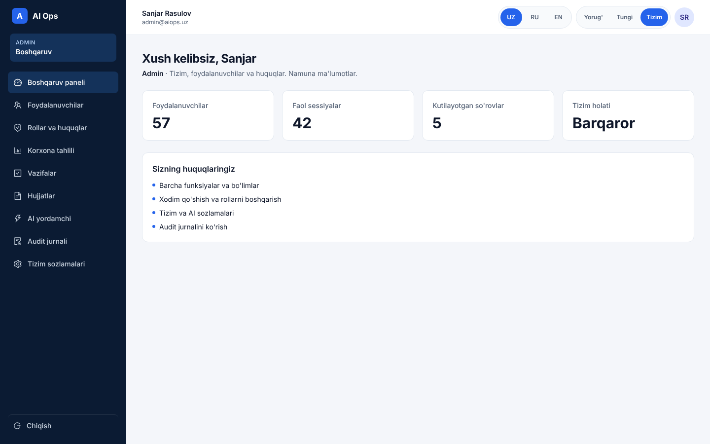
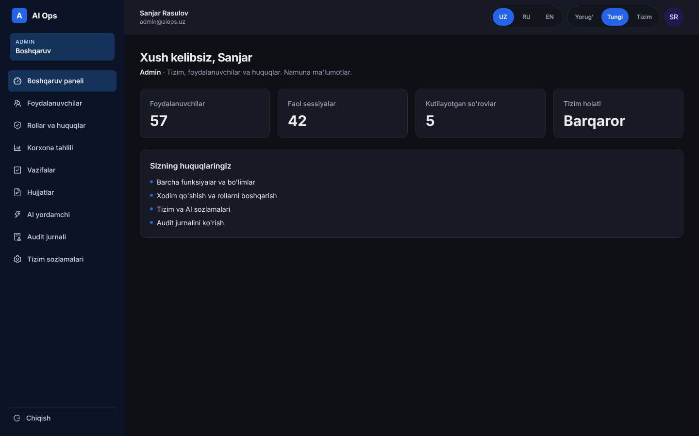
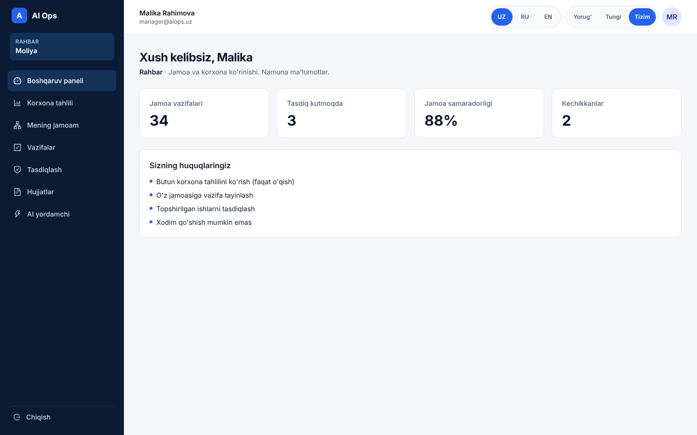
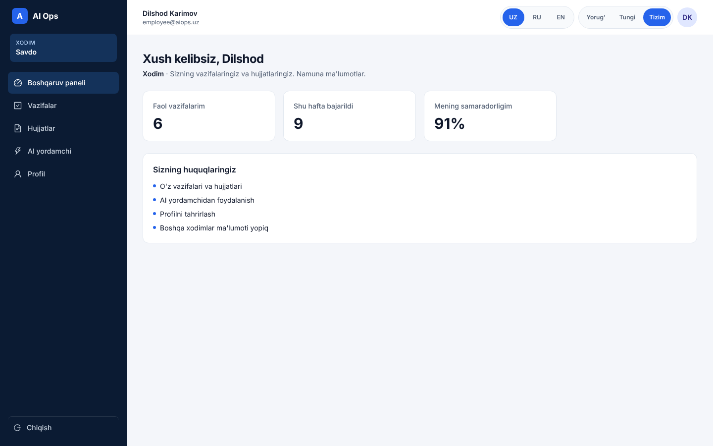
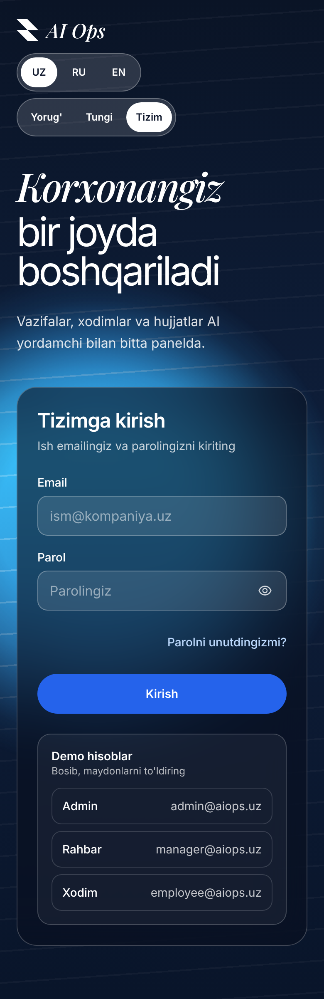
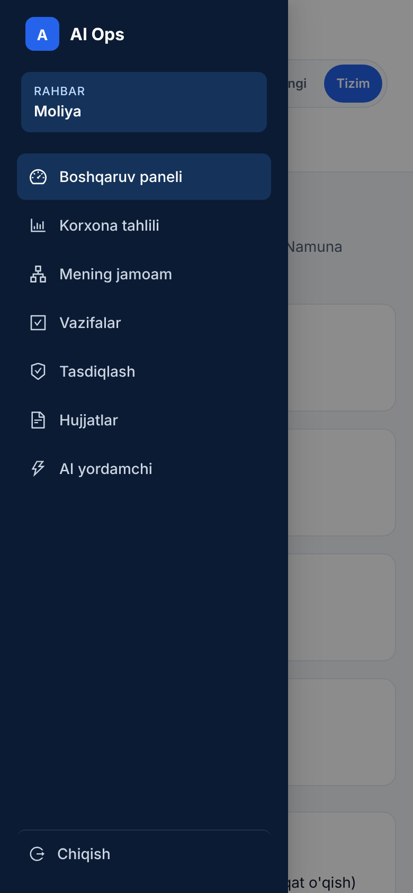

# 1-hafta hisoboti: poydevor, dizayn tizimi va kirish

**Loyiha:** AI biznes operatsion platformasi (boshqaruv paneli)
**Davr:** 1-hafta (4 haftadan)
**Branch:** `week-1/foundation`

## Qisqacha

Loyiha poydevori, dizayn tokenlari, Light/Dark rejim, uch tilli interfeys (uz, ru, en), Login/Logout/parolni tiklash va uch rolli (admin, rahbar, xodim) kirish tizimi tayyor. Rol login formasida tanlanmaydi: email va paroldan aniqlanadi. Hamma narsa avtomatik tekshirilgan: lint, typecheck, build va 20 ta brauzer testi o'tdi.

## Nima qildim

### 1. Loyiha poydevori

- Next.js 16 (App Router), TypeScript `strict`, Tailwind CSS 4, Ant Design 6.
- ESLint, Prettier (Tailwind plagini bilan), Husky + lint-staged (commit oldidan format, lint va typecheck).
- Xavfsizlik sarlavhalari (`X-Frame-Options`, `nosniff`, `Referrer-Policy`, `Permissions-Policy`), `X-Powered-By` o'chirilgan.
- `.env.example`, README (ishga tushirish, demo hisoblar, backend ulash qadamlari).

### 2. Dizayn tizimi

- Rang tokenlari (`--bg`, `--surface`, `--border`, `--accent`, `--sidebar` va boshqalar) Light va Dark uchun alohida; Tailwind va Ant Design bir xil qiymatlardan foydalanadi.
- Dizayn maydonida tasdiqlangan yo'nalish: A tuzilmasi, B ning to'q navy sidebar'i, C ga o'xshash tungi rejim.
- Umumiy komponentlar: `Button`, `TextField` (label, xato matni, `aria-*`), `LanguageSwitcher`, `ThemeToggle`, `AuthCard`.
- Shriftlar: Inter (kirill va lotin) va Playfair Display, `@fontsource` orqali (tashqi ulanishsiz).

### 3. Light / Dark rejim

- Uch holat: Yorug', Tungi, Tizim. Tanlov cookie'da saqlanadi, server birinchi chizishdayoq to'g'ri sinfni beradi.
- Ant Design `darkAlgorithm` bilan sinxron almashadi.

### 4. Login, Logout, parolni tiklash

- **Login:** Spotlight uslubi (kursor ortidan ochiladigan qatlam, canvas o'rniga CSS mask). Sensorli qurilmada va "harakatni kamaytirish" yoqilganda statik.
- **Parolni unutdim / yangi parol:** token 15 daqiqa amal qiladi, parol qoidasi (8+ belgi, katta/kichik harf, raqam) brauzerda ham, serverda ham bir xil Zod sxemasi bilan tekshiriladi.
- **Logout:** sessiya cookie'si o'chadi, himoyalangan sahifalar yopiladi.

### 5. Rollar

- **Admin:** barcha bo'limlar. **Rahbar:** korxonani ko'radi, o'z jamoasiga vazifa tayinlaydi, xodim qo'sha olmaydi. **Xodim:** o'z vazifalari va hujjatlari.
- Sidebar va bosh sahifa rolga qarab o'zgaradi. Ruxsat bo'lmagan sahifaga o'tilsa, bosh sahifaga qaytariladi.
- Himoya uch qatlamda: `proxy.ts`, `(app)` layout va har sahifada serverda.

### 6. Responsive

- Kompyuterda doimiy sidebar, telefonda menyu tugmasi va yon panel (Drawer). 390 px kenglikda gorizontal scroll yo'q (testda tekshirilgan).

## Xavfsizlik choralari

- Sessiya: imzolangan JWT (HS256), `httpOnly`, `sameSite=Lax`, production'da `secure`, 8 soat.
- Parol: mock hisoblar `scrypt` bilan xeshlangan, taqqoslash vaqt bo'yicha bir xil (`timingSafeEqual`), foydalanuvchi topilmasa ham.
- Hisob mavjudligi oshkor bo'lmaydi: "parolni unutdim" javobi har qanday email uchun bir xil.
- Brute-force: login 5 urinish / 15 daqiqa (email bo'yicha) va IP bo'yicha limit, `429` va `Retry-After`.
- CSRF qo'shimcha qatlami: API boshqa sayt `Origin`'idan kelgan so'rovni `403` bilan rad etadi.
- Open redirect: `?next=` faqat ichki yo'lni qabul qiladi (`//evil.example` rad etiladi).
- So'rov hajmi cheklangan (8 KB), kirish ma'lumotlari serverda Zod bilan tekshiriladi.

## Hal qilingan muammolar

1. **Tungi rejim yangilashdan keyin saqlanmadi.** Sabab: cookie nomi doimiysi `"use client"` faylidan serverga import qilingan edi, server unda matn o'rniga havola oladi. Natijada cookie o'qilmadi va mavzuni oldindan o'rnatuvchi skript buzildi. Doimiy oddiy umumiy faylga (`lib/theme.ts`) ko'chirildi, test qo'shildi.
2. **Next.js 16 o'zgarishlari.** `middleware` endi `proxy` deb ataladi; loyiha ichidagi rasmiy hujjat bo'yicha ishlandi. Shablon bilan kelgan `cacheComponents` o'chirildi: to'liq autentifikatsiyalangan va dinamik panel uchun ortiqcha murakkablik berar edi.
3. **`next/font/google` build vaqtida tashqi tarmoqqa ulanadi** va yopiq muhitda build yiqilishi mumkin. Shriftlar `@fontsource` paketlariga almashtirildi.
4. **Tailwind 4 va Ant Design stillari to'qnashuvi.** CSS qatlam tartibi (`@layer theme, base, antd, components, utilities`) va `AntdRegistry layer` bilan hal qilindi.
5. **Ildiz sahifa brauzer tiliga qarab `/en` ga ketardi.** Platforma asosan o'zbekcha bo'lgani uchun `localeDetection` o'chirildi: ildiz doim `/uz`.
6. **Parol maydoni locator'i** (testda) sarlavha bilan adashardi va Next.js'ning o'z `role="alert"` elementi bilan to'qnashdi; testlar aniqlashtirildi.

## Tekshiruv natijalari

| Tekshiruv                            | Natija            |
| ------------------------------------ | ----------------- |
| `npm run typecheck`                  | xatosiz           |
| `npm run lint`                       | xatosiz           |
| `npm run build`                      | muvaffaqiyatli    |
| Playwright E2E (production serverda) | **20 / 20 o'tdi** |

E2E qamrovi: sessiyasiz himoya, noto'g'ri parol, bo'sh forma, open redirect, cookie bayroqlari va cross-origin rad etish, har uch rolda kirish / ruxsat etilgan va taqiqlangan bo'limlar / chiqish, parolni tiklash (validatsiya va yaroqsiz token), til almashtirish, tungi rejim saqlanishi, telefonda menyu va scroll.

## Skrinshotlar

|                                                    |                                                             |
| -------------------------------------------------- | ----------------------------------------------------------- |
|             |          |
|     |  |
|  |           |
|     |       |

## Ma'lum cheklovlar

- **Backend mock.** Hisoblar xotirada; "yangi parol" tokenni tekshiradi, lekin parolni saqlamaydi (serverless'da saqlanadigan joy yo'q). Haqiqiy backend ulanganda almashtiriladi (README'da qadamlari bor).
- **Rate limit xotirada**, serverless'da har instansiyada alohida ishlaydi. Haqiqiy backendda markaziy limit kerak.
- **Demo hisoblar ro'yxati** login sahifasida `MOCK_AUTH_ENABLED=true` bo'lganda ko'rinadi. Ochiq deploy'da o'chirish kerak.
- **"Tizim" mavzusi:** tungi rejimli qurilmada Ant Design komponentlari sahifa yuklangandan keyin bir lahzaga yorug' chizilishi mumkin (aniq Yorug'/Tungi tanlovida bunday emas).
- **Vercel preview havolasi hali yo'q:** repozitoriy GitHub'ga yuklangach ulanadi.
- Ichki bo'limlar (Vazifalar, Hujjatlar va boshqalar) hozircha namunaviy sahifa; Table, Modal, Form 3-haftada.

## Keyingi hafta (2-hafta)

Sidebar, Header va Navigation'ni yakuniy dizaynga keltirish (qidiruv, bildirishnomalar, profil menyusi, nafaqat ikonka-panel varianti), breadcrumb, rolga qarab menyu guruhlari, bo'sh/xato/yuklanish holatlari.
