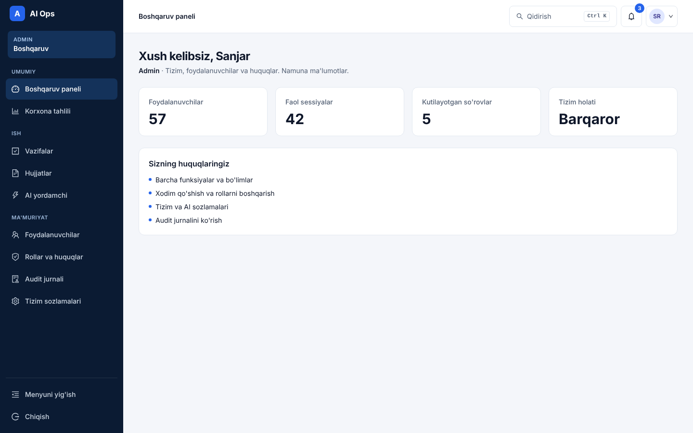
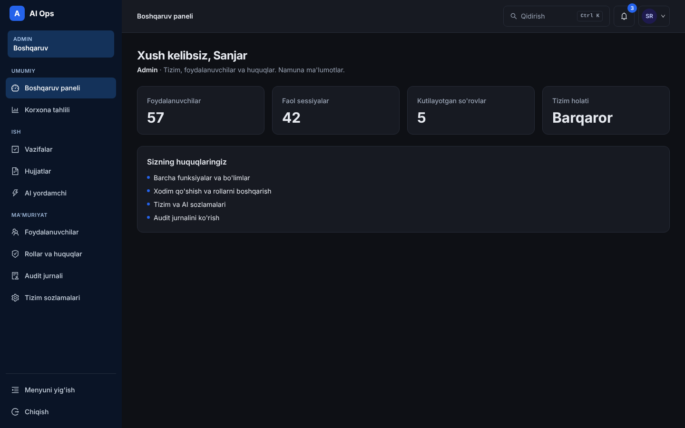
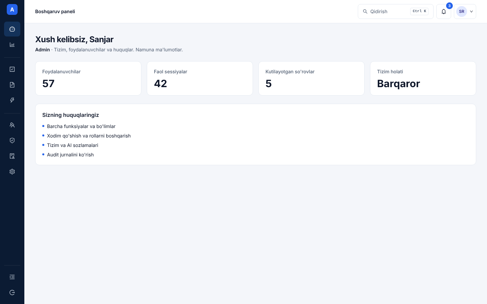
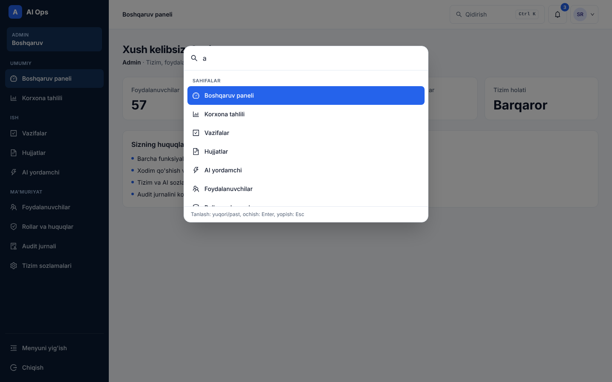
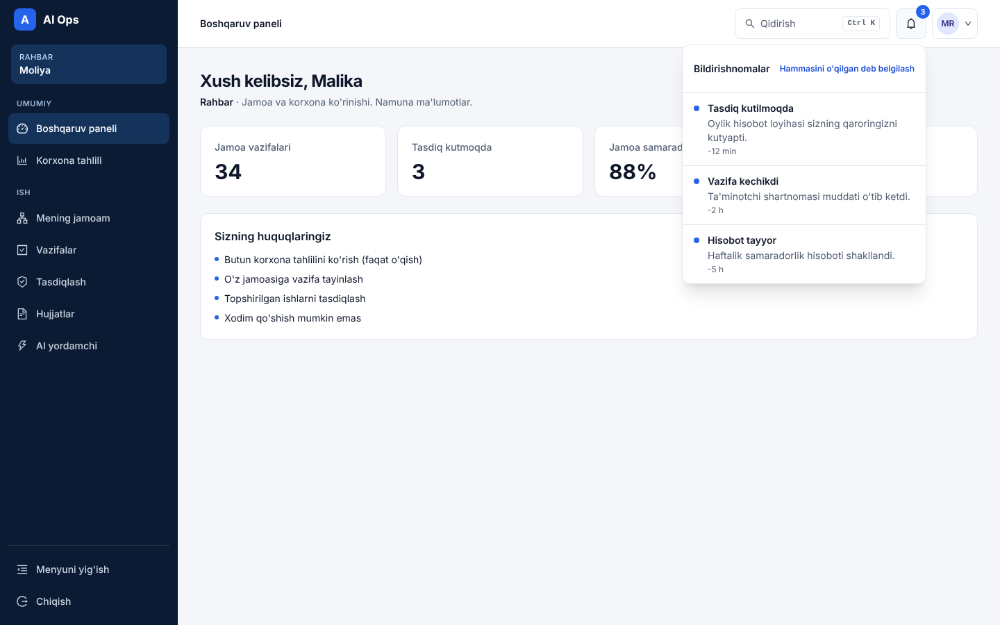
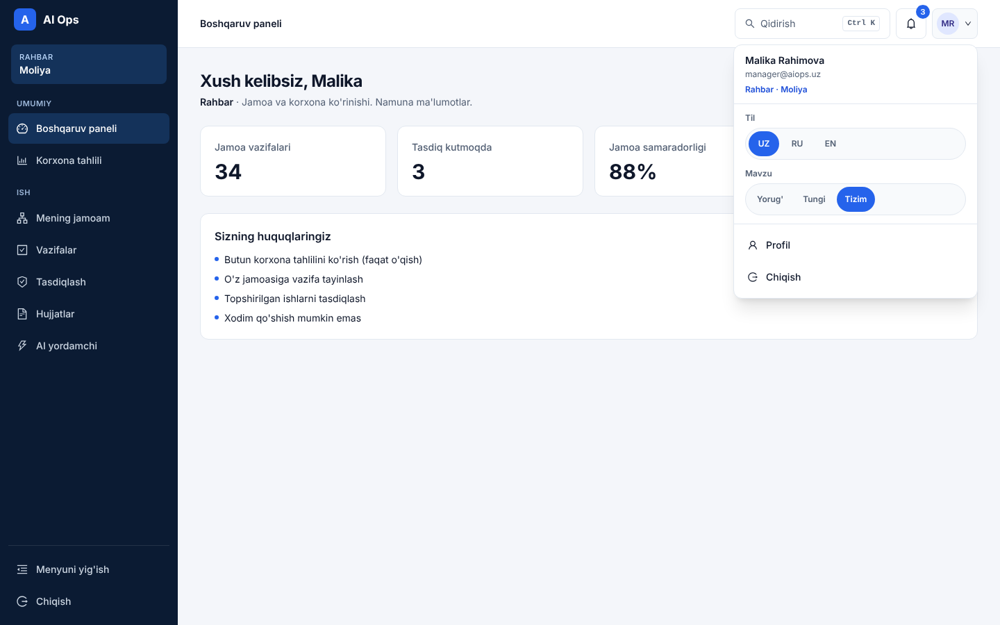
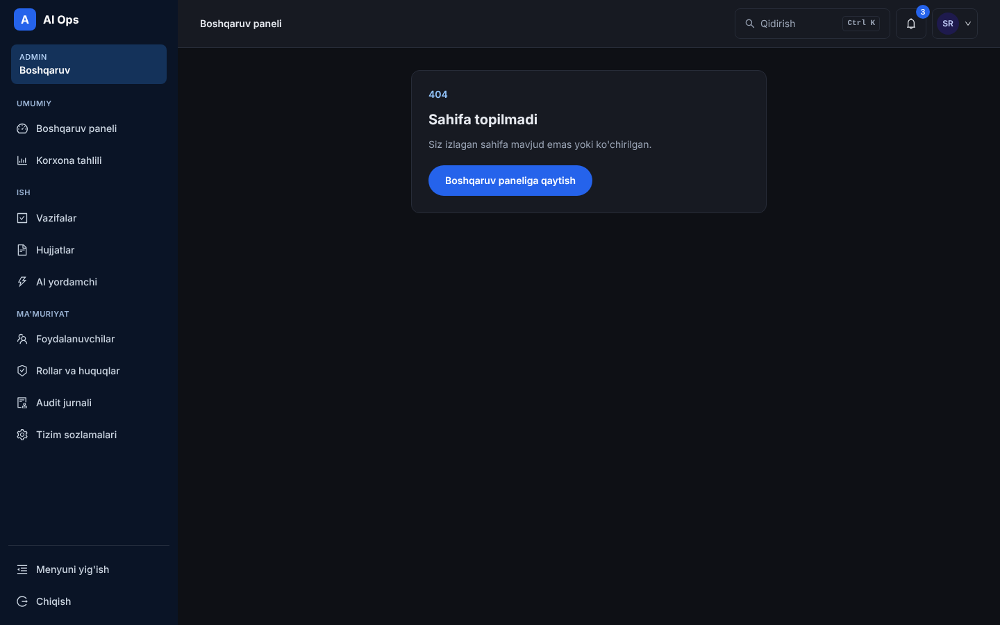
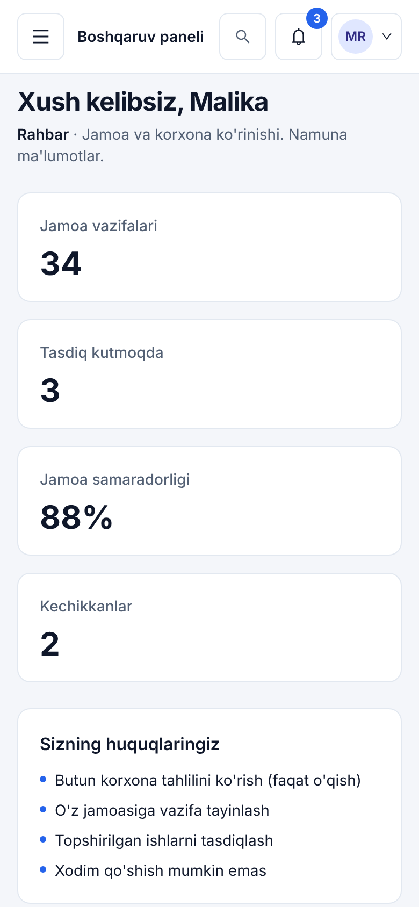
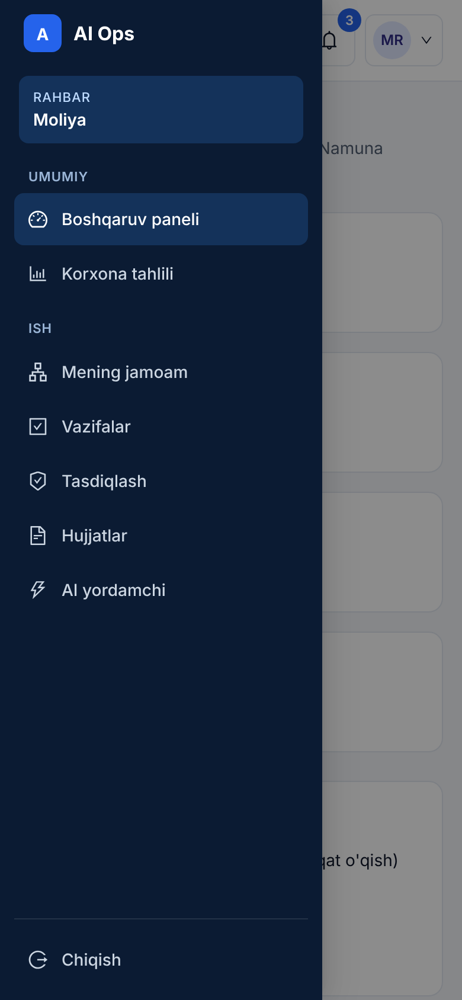

# 2-hafta hisoboti: Sidebar, Header va Navigation

**Loyiha:** AI biznes operatsion platformasi (boshqaruv paneli)
**Davr:** 2-hafta (4 haftadan)
**Branch:** `week-2/navigation`

## Qisqacha

Panel qobig'i yakuniy ko'rinishga keltirildi: rolga qarab guruhlangan sidebar (yig'iladigan), sarlavhada breadcrumb, tezkor qidiruv (Ctrl+K), bildirishnomalar va profil menyusi. Yuklanish, xato va 404 holatlari panel ichida ko'rsatiladi. Ish jarayonida 1-haftadagi login limitida xato topilib, tuzatildi. Natija: lint, typecheck, build va **39 ta brauzer testi** o'tdi.

## Nima qildim

### 1. Sidebar

- Menyu rolga qarab uch guruhga bo'lingan: **Umumiy**, **Ish**, **Ma'muriyat**. Admin uchta guruhni ko'radi, rahbar ikkitasini (Mening jamoam, Tasdiqlash bilan), xodim faqat o'z bo'limlarini.
- Kompyuterda yig'iladi (faqat ikonkalar) va yoyiladi. Holat cookie'da saqlanadi, shuning uchun sahifa yangilanganda "sakrash" bo'lmaydi: server birinchi chizishdayoq to'g'ri kenglikni beradi.
- Yig'ilgan holatda har bir havolada `aria-label` va `title` bor.
- Joriy sahifa `aria-current="page"` bilan belgilanadi.
- Telefonda sidebar Drawer sifatida ochiladi, havola bosilganda yopiladi.

### 2. Header

- **Breadcrumb:** `nav` + `aria-current`, joriy bo'lim ko'rsatiladi.
- **Tezkor qidiruv (Ctrl/Cmd+K):** sahifalar va amallar (Yorug'/Tungi/Tizim mavzusi, chiqish). Natijalar faqat rolga ruxsat etilgan sahifalarni ko'rsatadi: rahbar "Foydalanuvchilar" ni topa olmaydi. Strelka tugmalari, Enter, Esc ishlaydi. Brauzerning `<dialog>` elementi ustiga qurilgan, shuning uchun fokus qopqoni tayyor.
- **Bildirishnomalar:** o'qilmaganlar soni, bittasini yoki hammasini o'qilgan deb belgilash, nisbiy vaqt (`Intl.RelativeTimeFormat`, uch tilda). Tugma nomi sonni o'qib beradi: "Bildirishnomalar, o'qilmagan: 3".
- **Profil menyusi:** foydalanuvchi ma'lumoti, til, mavzu, profil, chiqish.
- Ikkala menyu ham umumiy `Popover` komponentida: Escape yopadi va fokusni tugmaga qaytaradi, tashqariga bosish yoki Tab bilan chiqish ham yopadi. Telefonda panel ekran kengligiga moslanadi.

### 3. Holatlar va qulaylik

- `loading.tsx`, `error.tsx` ("Qayta urinish" tugmasi bilan) va `not-found.tsx`: hammasi panel ichida, sidebar yo'qolmaydi.
- "Asosiy kontentga o'tish" havolasi (skip link): Tab bosilganda birinchi bo'lib chiqadi, Enter fokusni `<main>` ga o'tkazadi.
- Yangi matnlar uch tilda (uz, ru, en) qo'shildi; kalit to'plamlari bir xilligi tekshirildi (har birida 144 kalit).

## Hal qilingan muammolar

1. **Login limiti muvaffaqiyatli kirishlarni ham sanardi (1-haftadagi xato).** Navigatsiya testlarini ketma-ket ishga tushirganda 10 ta test login sahifasida qolib ketdi. Sabab: IP bo'yicha limit (20 / 15 daqiqa) barcha urinishlarni sanardi, ya'ni bitta ofis IP'sidan 20 ta xodim kirsa, hamma bloklanardi. Endi faqat **muvaffaqiyatsiz** urinishlar sanaladi (IP bo'yicha 20, hisob bo'yicha 5), muvaffaqiyatli kirish hisob hisoblagichini nolga qaytaradi. 3 ta yangi test qo'shildi (`e2e/security.spec.ts`): 25 ta to'g'ri kirish limitga tushmaydi; 5 ta xatodan keyin `429` + `Retry-After`; interfeysda "Juda ko'p urinish" xabari.
2. **Next.js 16 `error.tsx` API'si boshqacha.** Odatdagi `reset` prop o'rniga `retry` keladi. Loyiha ichidagi rasmiy hujjatdan topildi, shunga ko'ra yozildi.
3. **React compiler qoidasi (`react-hooks/refs`)** Popover'dagi `close` funksiyasini render-prop ichida chaqirishni xato deb topdi (ref'ga murojaat qiluvchi closure). Render-prop alohida `Slot` komponentida chaqiriladigan qilindi, `close` unga oddiy prop sifatida keladi.
4. **Test locator'i adashdi:** "Menyu" nomi "Hisob menyusi" tugmasiga ham mos kelardi. Aniq nom (`exact`) bilan tuzatildi.

## Tekshiruv natijalari

| Tekshiruv                            | Natija            |
| ------------------------------------ | ----------------- |
| `npm run typecheck`                  | xatosiz           |
| `npm run lint`                       | xatosiz           |
| `npm run build`                      | muvaffaqiyatli    |
| Playwright E2E (production serverda) | **39 / 39 o'tdi** |

Yangi testlar (19 ta): rolga qarab sidebar guruhlari, `aria-current`, yig'ish holati yangilashdan keyin saqlanishi, breadcrumb, bildirishnomalar (sanoq, o'qilgan, Escape fokusni qaytaradi), profil menyusi (mavzu, til yo'lni saqlaydi, chiqish), skip link, Ctrl+K (ochish, qidirish, strelkalar, rol bo'yicha filtr, mavzu amali), 404 panel ichida, 390 px da pop-over va qidiruv ekrandan chiqmaydi, telefon Drawer'i, login limiti.

## Skrinshotlar

|                                                         |                                                     |
| ------------------------------------------------------- | --------------------------------------------------- |
|      |    |
|  |   |
|       |      |
|                  |  |
|         |                                                     |

## Ma'lum cheklovlar

- Bildirishnomalar mock ma'lumot; "o'qilgan" holati faqat brauzer xotirasida (sahifa yangilansa tiklanadi). Haqiqiy backendda serverga yoziladi.
- Rate limit hamon xotirada (serverless'da har instansiyada alohida); haqiqiy backendda markaziy limit kerak.
- Tezkor qidiruv hozircha sahifalar va amallarni qidiradi; vazifa/hujjat/xodim bo'yicha qidiruv ma'lumotlar paydo bo'lgach (3-hafta) qo'shiladi.
- Vercel preview hali ulanmagan.

## Keyingi hafta (3-hafta)

Modal va tasdiqlash dialogi, Table (saralash, qidiruv, sahifalash, bo'sh/yuklanish holati), Form maydonlari; ularni ishlatadigan sahifalar: Foydalanuvchilar (admin), Vazifalar, Mening jamoam; serverda rol tekshiriladigan mock API.
