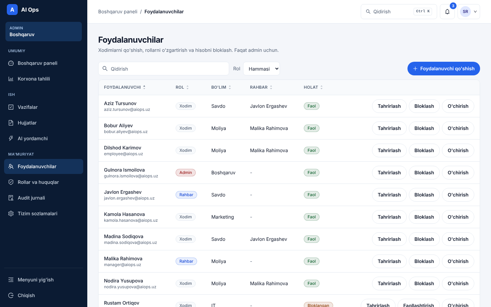
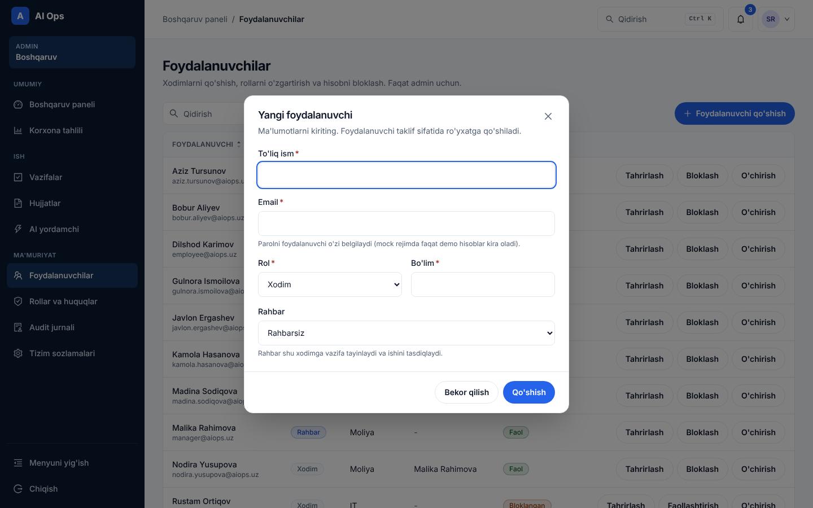
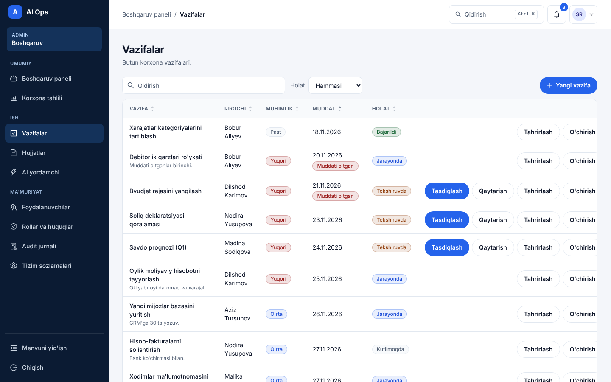
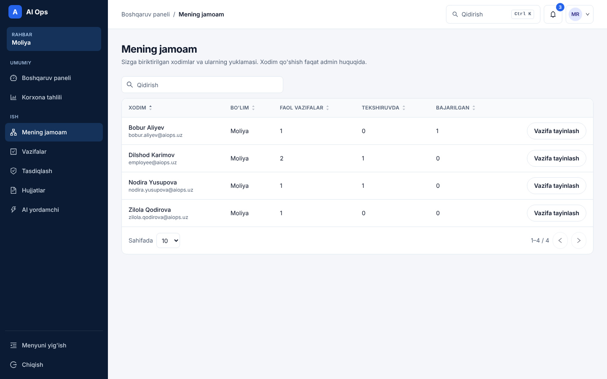
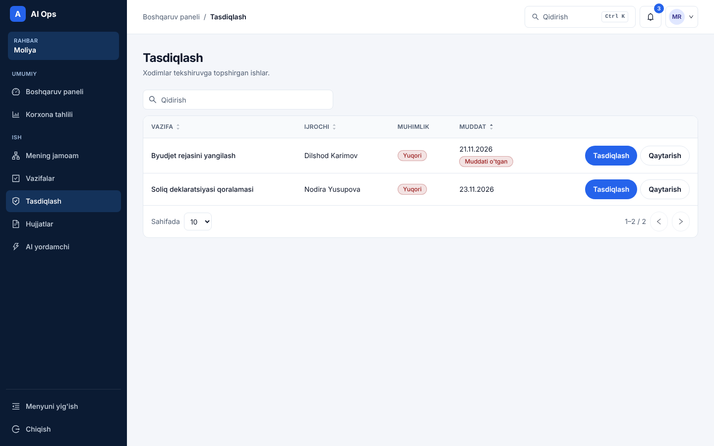
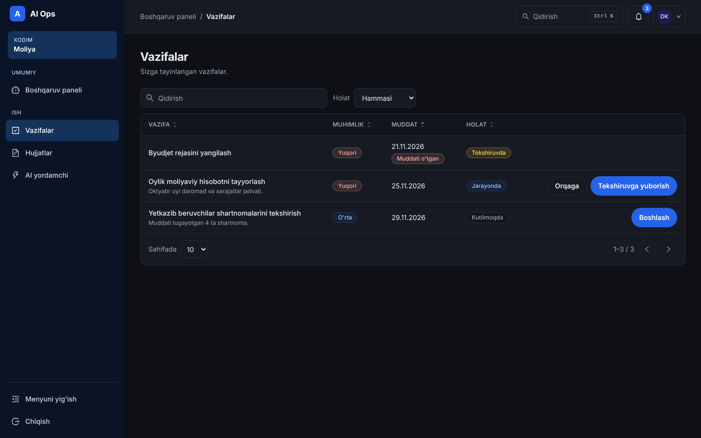
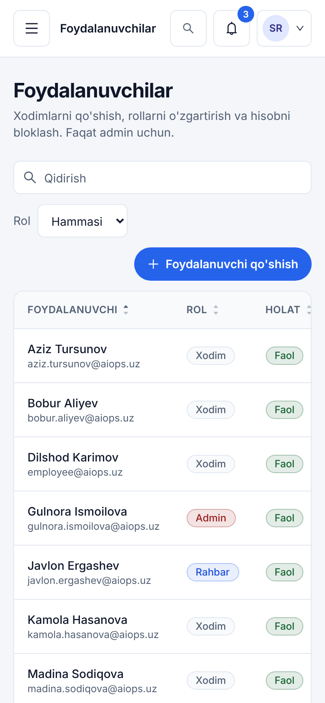

# 3-hafta hisoboti: Modal, Table, Form va ularni ishlatadigan sahifalar

**Loyiha:** AI biznes operatsion platformasi (boshqaruv paneli)
**Davr:** 3-hafta (4 haftadan)
**Branch:** `week-3/data-components`

## Qisqacha

Modal, Table va Form komponentlari tayyor va haqiqiy sahifalarda ishlatilmoqda: **Foydalanuvchilar** (admin), **Vazifalar** (barcha rollar), **Mening jamoam** va **Tasdiqlash** (rahbar). Ma'lumotlar serverdagi mock API orqali keladi va **ruxsatlar serverda tekshiriladi**, ya'ni tugmani yashirish yetarli deb hisoblanmagan. Natija: lint, typecheck, tarjimalar tekshiruvi, build va **74 ta brauzer testi** o'tdi (35 tasi yangi).

## Nima qildim

### 1. Umumiy komponentlar (`src/components/ui`)

- **Modal:** brauzerning `<dialog>` elementi ustiga qurilgan. Fokus ichkarida qoladi (Tab chiqib ketmaydi), orqa fon bosilmaydi, Esc va fon bosish yopadi, yopilganda fokus ochgan tugmaga qaytadi. Ichki mazmun faqat ochiq paytda chiziladi, shuning uchun forma har safar toza ochiladi. Telefonda ekranga sig'adi.
- **ConfirmDialog:** o'chirish kabi xavfli amallar uchun tasdiqlash (xavfli amal tugmasi alohida rangda, fokus xavfsiz tugmada).
- **DataTable:** qidiruv, ustun bo'yicha saralash (`aria-sort`), sahifalash va sahifadagi qatorlar soni, filtr uchun joy, bo'sh va yuklanish holati, `<caption>`. Ikkinchi darajali ustunlar telefonda yashiriladi, jadval sahifani kengaytirmaydi (testda tekshirilgan).
- **Form maydonlari:** matn, tanlov, sana, ko'p qatorli; har birida label, yordam matni, xato matni va `aria-*`.
- **Badge, EmptyState, Toast, PageHeader.**

### 2. Sahifalar

- **Foydalanuvchilar (faqat admin):** qo'shish, tahrirlash, bloklash / qayta faollashtirish, o'chirish; rol bo'yicha filtr, qidiruv, saralash.
- **Vazifalar:** xodim o'z vazifalarini ko'radi va holatini o'zgartiradi, tekshiruvga yuboradi. Rahbar o'z jamoasiga vazifa tayinlaydi, tahrirlaydi. Admin hammasini ko'radi.
- **Tasdiqlash (rahbar):** tekshiruvdagi ishlarni tasdiqlash yoki sabab yozib qaytarish.
- **Mening jamoam (rahbar):** jamoa a'zolari va ularning ochiq / tekshiruvdagi / bajarilgan vazifalari soni.
- Dashboarddagi "Tasdiq kutmoqda" soni tasdiqlash ro'yxatiga mos.

### 3. Server tomoni (mock API)

- `/api/users`, `/api/tasks` (+ `[id]`): har so'rovda sessiyadan foydalanuvchi olinadi va **hozirgi holati** bo'yicha ruxsat tekshiriladi.
- Qoidalar: xodim foydalanuvchilarni ko'ra olmaydi; rahbar xodim qo'sha olmaydi; rahbar faqat o'z jamoasiga vazifa tayinlaydi va boshqa jamoa vazifasini ko'rmaydi; xodim o'z ishini o'zi tasdiqlay olmaydi; admin o'zini bloklay, pastlata va o'chira olmaydi; qaytarishda sabab majburiy; yakunlanmagan vazifasi bor foydalanuvchini o'chirib bo'lmaydi.
- Kirish ma'lumotlari Zod bilan tekshiriladi (brauzerdagi sxema bilan bir xil), noto'g'ri tana `400`, juda katta tana `413`, sessiyasiz so'rov `401`, boshqa saytdan yozuvchi so'rov `403` (CSRF).
- Bloklangan yoki o'chirilgan foydalanuvchining eski sessiyasi ham yaroqsiz bo'ladi: panel uni login sahifasiga qaytaradi va cookie'ni tozalaydi.
- Ma'lumotlar ombori `globalThis` da (xotirada); haqiqiy backendda `src/lib/data/service.ts` funksiyalari API chaqiruvlariga almashtiriladi.

### 4. Tarjimalar

- Yangi matnlar uch tilda (uz, ru, en). `npm run check:i18n` skripti kalit to'plamlari bir xilligini va kodda ishlatilgan har bir kalit mavjudligini tekshiradi: hozir 315 kalit / til.

## Hal qilingan muammolar

1. **Bloklash faqat interfeysda bo'lib qolmasligi kerak edi.** Bloklangan foydalanuvchi imzosi yaroqli cookie bilan 8 soat kira olardi. Endi har so'rovda hisob holati tekshiriladi va sessiya tugatiladi (`session-expired`), test bilan.
2. **Sanalar "2026 M11 21" ko'rinishida chiqdi.** Brauzerning `uz` uchun sana qoliplari ishonchsiz. Sana hamma tilda `kun.oy.yil` formatiga o'tkazildi.
3. **Telefonda breadcrumb matni bir-biriga o'tib ketdi** (qisqartiriladigan element `inline` edi). Endi telefonda faqat joriy bo'lim ko'rsatiladi, kompyuterda to'liq yo'l.
4. **Telefonda jadval qatorlari juda baland bo'lib ketdi**: amal tugmalari ustma-ust tushardi. Tugmalar bir qatorda qoladi, jadval o'z ichida gorizontal siljiydi, sahifa esa kengaymaydi.
5. **Next.js route handler va server komponentlar ma'lumot omborining alohida nusxalarini olishi mumkin.** Holat `globalThis` ga olindi, shunda ikkala tomon bitta nusxani ko'radi.

## Tekshiruv natijalari

| Tekshiruv                            | Natija            |
| ------------------------------------ | ----------------- |
| `npm run typecheck`                  | xatosiz           |
| `npm run lint`                       | xatosiz           |
| `npm run check:i18n`                 | to'liq            |
| `npm run build`                      | muvaffaqiyatli    |
| Playwright E2E (production serverda) | **74 / 74 o'tdi** |

Yangi testlar: API ruxsatlari (401, CSRF, rol bo'yicha taqiqlar, admin o'zini o'chira olmaydi, takroriy email, tana tekshiruvi), vazifa aylanishi (tayinlash → bajarish → tekshiruv → qaytarish → tasdiqlash uch rol bilan), jadval (qidiruv, saralash, sahifalash, filtr), foydalanuvchini qo'shish / tahrirlash / bloklash / o'chirish, modal klaviatura xatti-harakati, bloklangan foydalanuvchi sessiyasi, telefonda jadval va modal.

## Skrinshotlar

|                                                  |                                                      |
| ------------------------------------------------ | ---------------------------------------------------- |
|  |                  |
|  |        |
|  |  |
|  |                                                      |

## Ma'lum cheklovlar

- **Mock ma'lumotlar xotirada:** server qayta ishga tushsa boshlang'ich holatga qaytadi.
- **Jadval ma'lumotni to'liq brauzerda saralaydi va sahifalaydi.** Mock hajmi uchun yetarli; katta hajmda serverga o'tkaziladi (komponent interfeysi o'zgarmaydi).
- Yangi foydalanuvchi paroli mock rejimda belgilanmaydi (faqat demo hisoblar kira oladi).
- "Rollar va huquqlar", "Audit jurnali", "Tizim sozlamalari", "Hujjatlar", "AI yordamchi" hozircha namunaviy sahifa.
- Vercel preview hali ulanmagan.

## Keyingi hafta (4-hafta)

Responsive tekshiruv (390 / 768 / 1440 px), uch tilning to'liqligi, qulaylik (axe) avtomatik tekshiruvi, qolgan sahifalarni sayqallash, yakuniy hisobot va README.
