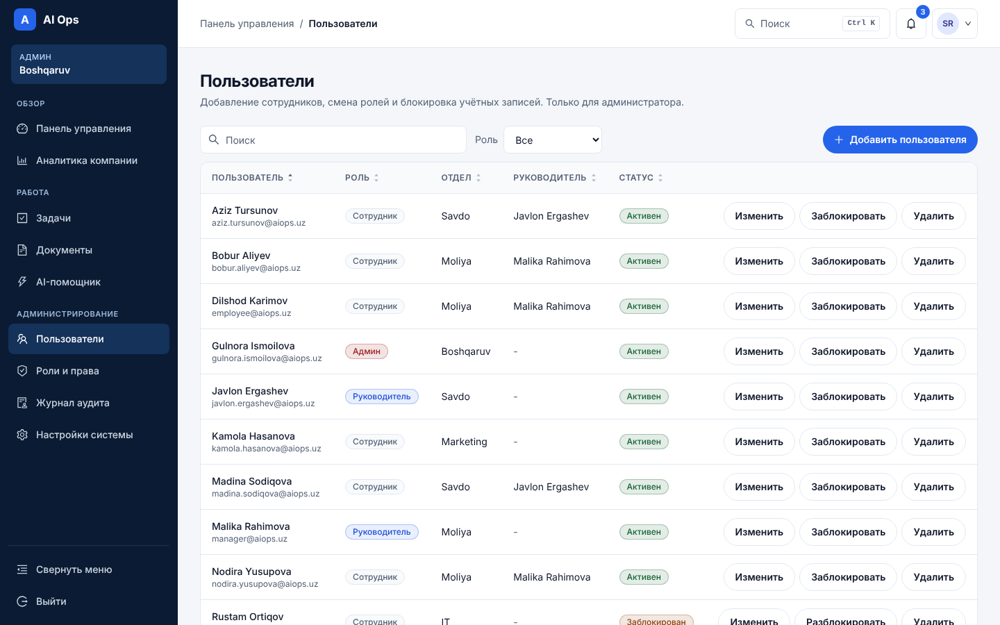
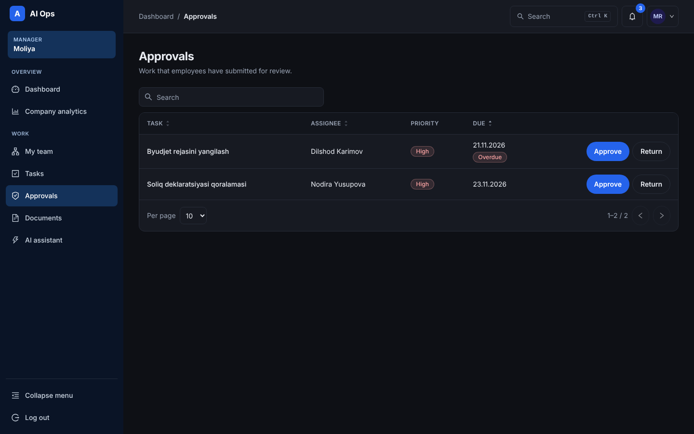
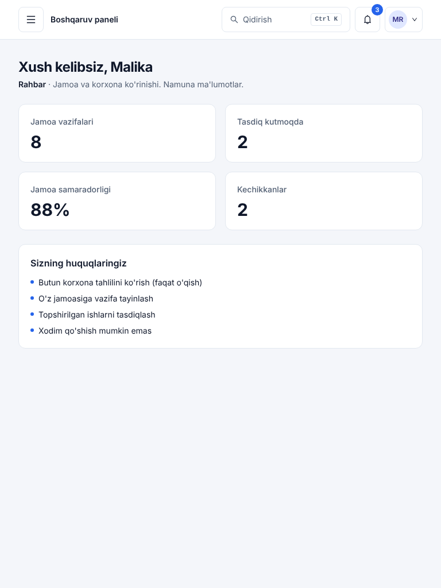
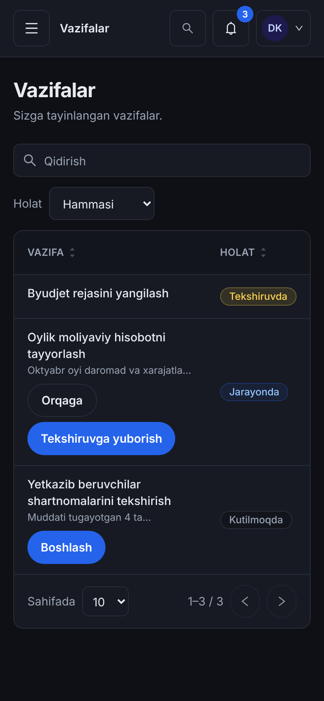
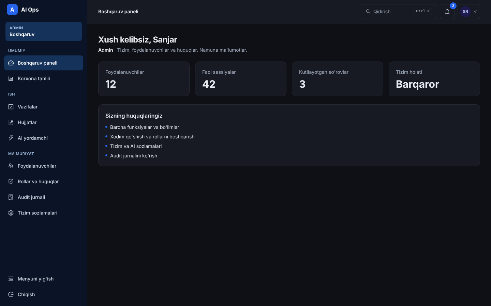

# 4-hafta hisoboti: responsive, qulaylik, sayqal va yakuniy tekshiruv

**Loyiha:** AI biznes operatsion platformasi (boshqaruv paneli)
**Davr:** 4-hafta (4 haftadan)
**Branch:** `week-4/polish`

## Qisqacha

Platforma 390 / 768 / 1440 px kengliklarda tekshirildi, uch rol, ikki rejim (Light/Dark) va uch tilda (uz, ru, en) qulaylik (axe, WCAG 2.2 AA) bo'yicha skanerlandi. Skaner 3 ta haqiqiy xatoni topdi, hammasi tuzatildi; telefondagi jadval amallari qayta o'ylab chiqildi. Natija: lint, typecheck, tarjimalar tekshiruvi, build va **107 ta brauzer testi** o'tdi.

## Nima qildim

### 1. Qulaylik: avtomatik axe tekshiruvi (`e2e/a11y.spec.ts`)

- Har uch rolning **barcha sahifalari**, Light va Dark rejimda (WCAG 2.0/2.1/2.2 A va AA qoidalari, jumladan rang kontrasti va bosish maydoni o'lchami).
- Ochiq sahifalar (login, parolni tiklash) uch tilda va ikki rejimda.
- Ochiq overlay'lar: modal, bildirishnomalar paneli, tezkor qidiruv.
- Bu testlar endi regressiyadan ham himoya qiladi: yangi sahifada kontrast yoki nom xatosi bo'lsa, test yiqiladi.

### 2. Responsive tekshiruv (`e2e/responsive.spec.ts`)

- 390 px (telefon), 768 px (planshet), 1440 px (kompyuter): har rol uchun hamma sahifada gorizontal scroll yo'qligi.
- Yon panel: 1024 px dan boshlab doimiy, undan kichikda menyu tugmasi va Drawer.
- Sarlavha tugmalari ekran ichida va kamida 24 × 24 px.
- Forma modali har uch kenglikda ekranga sig'adi.

### 3. Telefondagi jadval amallari

Telefonda jadvalning ikkinchi darajali ustunlari yashirinadi, lekin amal tugmalari ustuni yon tomonga siljib ketib, xodim vazifa holatini o'zgartirish uchun jadvalni surishi kerak edi (topilishi qiyin). `DataTable` ga `mobileInline` xususiyati qo'shildi: telefonda amallar birinchi ustun ichida, matn tagida ko'rsatiladi; planshet va kompyuterda alohida ustun. Foydalanuvchilar, Vazifalar, Tasdiqlash va Jamoa jadvallarida qo'llangan, testlar bilan.

### 4. Yakuniy tekshiruv va hujjatlar

- Har uch tilda kalitlar to'liqligi (`npm run check:i18n`): 315 kalit / til, kodda ishlatilgan hamma kalit mavjud.
- README yangilandi (holat, skriptlar, tuzilma).
- Haftalik hisobotlar: `reports/week-1.md` … `week-4.md`, skrinshotlar bilan.

## Hal qilingan muammolar

1. **Qidiruv tugmasi nomi ko'rinadigan matnga mos emas edi (WCAG 2.5.3).** Tugmada "Qidirish Ctrl K" ko'rinar, lekin ekran o'qish dasturi faqat `aria-label` ni o'qirdi. `aria-label` olib tashlandi, matn tugmaning o'z mazmuni bo'ldi (telefonda faqat ikonka, matn `sr-only`), `Ctrl K` esa `aria-keyshortcuts` orqali beriladi.
2. **Profil tugmasidagi bosh harflar ("SR") nomga kirmasdi.** Bosh harflar endi CSS orqali chiziladi (matn DOM'da yo'q), tugma nomi "Hisob menyusi" qoladi.
3. **"Faollashtirish" tugmasining nomi "Blokdan chiqarish: Ism" edi** (uch tilda ham). Ko'rinadigan matn nomga mos qilindi: "Blokdan chiqarish" / "Разблокировать" / "Unblock".
4. **Jadval sarlavhasidagi saralash tugmasi 20 px balandlikda edi** (talab 24 px). `min-h-7` berildi.
5. **Test artefakti:** ochiq panel ostidagi sahifa qismini skanerlash "yopilgan element" xatosini berdi. Overlay testlari faqat o'sha overlay'ning o'zini skanerlaydigan qilindi.
6. **Telefonda sana va breadcrumb** (3-haftada topilgan) responsive testlari bilan mustahkamlandi.

## Tekshiruv natijalari

| Tekshiruv                            | Natija              |
| ------------------------------------ | ------------------- |
| `npm run typecheck`                  | xatosiz             |
| `npm run lint`                       | xatosiz             |
| `npm run check:i18n`                 | to'liq              |
| `npm run build`                      | muvaffaqiyatli      |
| Playwright E2E (production serverda) | **107 / 107 o'tdi** |

| Qamrov                           | Testlar |
| -------------------------------- | ------- |
| Kirish, himoya, parolni tiklash  | 20      |
| Navigatsiya (sidebar, header)    | 16      |
| Login limiti                     | 3       |
| API, vazifalar, foydalanuvchilar | 35      |
| Qulaylik (axe)                   | 13      |
| Responsive                       | 20      |

## Skrinshotlar

|                                                         |                                                                |
| ------------------------------------------------------- | -------------------------------------------------------------- |
|  |  |
|          |             |
|        |                                                                |

## Qolgan ishlar va cheklovlar (loyiha 4 haftalik doirasida)

- **Backend mock:** ma'lumotlar va hisoblar xotirada; server qayta ishga tushsa, boshlang'ich holatga qaytadi. Haqiqiy backendga o'tish qadamlari README'da.
- **Avtomatik axe tekshiruvi qulaylikning hammasini kafolatlamaydi:** ekran o'qish dasturi bilan qo'lda sinov va klaviatura yurishlarini (qisman E2E'da bor) kengaytirish tavsiya etiladi.
- **Ochiq internetga chiqarishdan oldin:** `MOCK_AUTH_ENABLED` ni o'chirish (demo hisoblar ro'yxati yo'qoladi), markaziy rate limit, haqiqiy parol saqlash va pochta.
- Namunaviy sahifalar: Rollar va huquqlar, Audit jurnali, Tizim sozlamalari, Hujjatlar, AI yordamchi, Korxona tahlili. Ular uchun interfeys keyingi bosqichda.
- Vercel preview ulanmagan (repozitoriy va loyiha egasining tasdig'ini kutadi).
